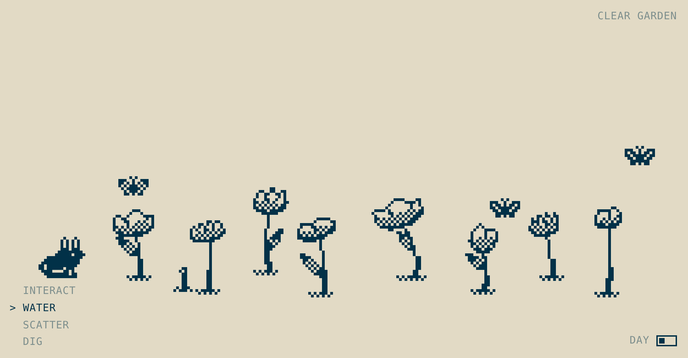

# Random Flowers

A tiny interactive pixel garden. Click to water the ground and a pixel flower grows; water it again and it gets bigger. Plant enough and the garden comes alive with butterflies, a worm, a bunny and, at night, glow worms.

**Live:** https://joellelau.github.io/randomflowers/



## How to play

Pick a tool from the menu in the bottom-left corner, then click in the garden.

| Tool | What it does |
|---|---|
| **Water** | Plant a new flower, or water an existing one to grow it (up to 5 times). Water scattered seeds to grow a dandelion. |
| **Interact** | Brush past flowers to make them sway. Touch a critter and it runs off. Touch a dandelion and its seeds blow away on the wind. |
| **Scatter** | Sprinkle seeds on the ground. Sparrows fly in to eat them, so water them quickly. |
| **Dig** | Dig up a flower. |

The **Day / Night** switch in the bottom-right corner changes the time of day, and **Clear Garden** in the top-right starts over.

Every flower is randomly generated (height, lean, petals, leaves), so no two are the same.

## Who visits the garden

| Visitor | When |
|---|---|
| Butterflies (up to 3) | 4+ flowers, daytime. They flutter around and rest on blooms. |
| Worm | 5+ flowers. It pops out of the ground now and then. |
| Bunny (1) | 6+ flowers. It hops between open patches of ground, nibbles, and hops off out of frame. It never walks through flowers. |
| Sparrows (up to 2) | When there are seeds on the ground, daytime only. |
| Glow worms (up to 5) | 4+ flowers, night only. They replace the butterflies. |

## Embedding it

The whole garden is a single web component, `<pixel-garden>`, with no dependencies. `index.html` is the full page.

**In Framer:** add an **Embed**, set it to **URL**, and paste the live link. The garden fills whatever size you give the Embed.

**In your own page:** copy the `<pixel-garden>` tag and the `<script>` that defines it from `index.html`:

```html
<pixel-garden fill></pixel-garden>
<script>/* … the pixel-garden script from index.html … */</script>
```

Without `fill`, give it a height in CSS, e.g. `style="height: 420px"`.

### Options

| Attribute | Default | What it does |
|---|---|---|
| `fill` | | Fill the parent's height (use this inside embeds) |
| `pixel-size` | `4` | Size of one art pixel, in CSS pixels |
| `ink` / `paper` | `#013148` / `#E2DAC5` | Line and background colours |
| `night-ink` / `night-paper` | day colours swapped | Night-time colours |
| `night` | | Start in night mode |
| `mode` | `water` | Starting tool: `interact`, `water`, `scatter` or `dig` |
| `max-flowers` | `60` | Oldest flowers are removed past this |
| `avoid` | | CSS selectors for page elements flowers shouldn't grow over (e.g. `#clear-garden`) |
| `no-tools` | | Hide the tool menu |
| `no-night` | | Hide the day/night switch |

### From JavaScript

```js
const garden = document.querySelector('pixel-garden');
garden.clear();              // clear the garden
garden.mode = 'dig';         // switch tools
garden.night = true;         // switch to night

garden.addEventListener('modechange',  e => console.log(e.detail.mode));
garden.addEventListener('nightchange', e => console.log(e.detail.night));
```

## Notes

- Works with mouse and touch. On phones, tap to use the current tool.
- If the visitor's device is set to reduce motion, flowers appear fully grown instead of animating.
- Animation pauses while the garden is scrolled out of view.
- The garden resets when the page reloads.
